<h1 align="center">Kitten Assistant</h1>

<p align="center">
  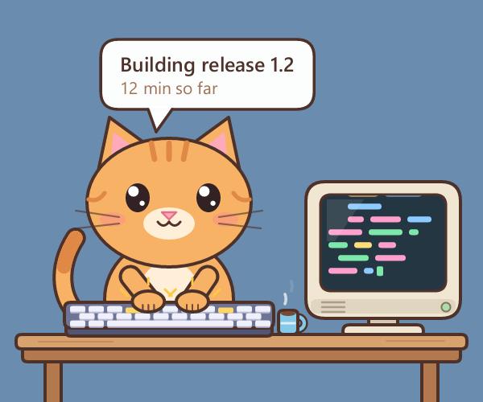
</p>

<p align="center">
  <a href="https://github.com/Hailey-Ross/hails.Kitten-Assistant/actions/workflows/release.yml"></a>
  <a href="https://github.com/Hailey-Ross/hails.Kitten-Assistant/releases/latest"></a>
</p>

Kitten Assistant is a tiny desktop buddy for Windows. A kitten sits at a little computer on top of your taskbar and acts out whatever your background jobs are doing: it types while a build runs, waits with its chin on a paw, frowns when something fails, cheers when a job is done and naps when nothing is running. A speech bubble shows the current status line and how long it has been going.

Why? Long jobs (builds, renders, test runs, backups, scripts) give no sign of life while they work in the background. Anything that can write one line of text can drive the kitten, so a glance at the corner of the screen tells you whether something is still running.

> **Heads up:** it runs on Windows 10 and 11 (64-bit). It's one small exe: no installer, no runtime, no tray icon. Keep it in a folder you can write to, because it saves its settings and its updates next to the exe.

## What I'm aiming for

- **Glanceable.** One short line and a mood you can read from across the room. No windows to open, no notifications to dismiss.
- **Anything can drive it.** A command, a text file, a script in any language. If it can write a file, it can tell the kitten what it's doing.
- **Light.** It runs at the lowest CPU priority in Windows' efficiency mode, draws about 30 frames a second while busy and 15 while napping (a frame takes 1 to 2 ms to draw, a few percent of one CPU core), and keeps animating while a full-screen game has the focus without ever taking the focus itself.
- **Out of the way.** The window has no frame, is see-through around the kitten, has no taskbar button, and clicks on the clear parts go through to whatever is behind it.

## Getting started

1. Download `kitten-assistant.exe` from the **[latest release](https://github.com/Hailey-Ross/hails.Kitten-Assistant/releases/latest)**.
2. Put it in a folder of its own that you can write to, for example `C:\Tools\KittenAssistant`. Not Program Files: the kitten saves its settings and updates next to the exe.
3. Double-click it. A kitten appears at the bottom-right of your screen, sitting on the taskbar, asleep on its keyboard.
4. Open a terminal (PowerShell, Command Prompt or Git Bash) in that folder and try it:

   ```
   .\kitten-assistant.exe say "Trying out the kitten"
   ```

   Within two seconds it wakes up, types, and the bubble shows your line. Send it back to sleep with `.\kitten-assistant.exe idle`.
5. Close it with `.\kitten-assistant.exe quit`, or right-click the kitten and pick **Quit**.

Only one kitten runs at a time; starting a second one does nothing, so it's safe to put `kitten-assistant` at the top of every script. To start it with Windows, press Win+R, type `shell:startup`, and put a shortcut to `kitten-assistant.exe` in the folder that opens (add any options at the end of the shortcut's **Target** field).

The `experimental` pre-release on the releases page is the newest test build of `main`. Pick it only if you want to try unfinished changes: it never updates itself.

### Staying up to date

A kitten from a numbered release keeps itself up to date:

- It checks GitHub **30 seconds after it starts, then every 6 hours**.
- When a newer stable release is out, it downloads it, checks it against the SHA-256 the release publishes, swaps it in and restarts with the same options. Your status, color and position stay.
- `kitten-assistant update` checks right away. With a kitten running, that kitten checks and restarts only if there's something newer; with none running, it updates the exe and tells you in a message box.
- To turn automatic updates off, add the line `auto_update=0` to `kitten-assistant.ini` next to the exe.
- Pre-releases (the `experimental` build) are never installed this way, and the `experimental` build and builds you make yourself never update themselves.

Update problems are written to `%TEMP%\kitten-assistant.log`.

## Telling the kitten what you're doing

```
kitten-assistant say "Building release 1.2"
kitten-assistant "Building release 1.2"
kitten-assistant idle
kitten-assistant quit
```

- `say` writes your line to the status file; text that isn't a command works the same without `say`. A status that is exactly one command word (`quit`, `update`, `version`, `help`, `snapshot`) runs that command instead, so use `say` for those.
- `idle` sends the kitten back to its nap. Always end a job with it, or the kitten keeps typing.
- The bubble's timer starts again whenever the text changes. Saying the same line again keeps the count going.
- Short lines read best (about 50 characters fit; longer text is cut to two lines). Put the useful words first.
- **In PowerShell, add `| Out-Null`** (`kitten-assistant say "Backup" | Out-Null`), or the next line of your script can run before the status is written.

> **Never start a status with `--`.** Anything starting with `--` is read as an option, even inside quotes and even after `say`. `kitten-assistant "--check-assets hang"` is an unknown option: the status is not written, and an error message box opens and keeps the call (and any script waiting on it) stuck until someone clicks OK. Put a word in front instead: `kitten-assistant "Check: --check-assets hang"`.

### The status file

Behind the scenes, the kitten reads the **first line** of a status file every 2 seconds. That means anything that can write a file can drive it, no exe call needed:

```powershell
# PowerShell
Set-Content -Path C:\jobs\status.txt -Value "Nightly backup"
```

```bash
# bash / Git Bash / WSL
echo "Running tests" > /c/jobs/status.txt
```

```python
# Python
open(r"C:\jobs\status.txt", "w").write("Training model, epoch 3")
```

| First line of the file | What the kitten does |
|------------------------|----------------------|
| any text | acts out the mood its first word picks (see below), and the bubble shows the text |
| empty, only spaces, `idle`, or no file at all | naps (after a short cheer if a job just ended) |

The default file is `status.txt` next to the exe. Pick another with `--status FILE` or the `KITTEN_STATUS` environment variable; the running kitten and every `say` / `idle` must point at the same file. In Windows PowerShell 5.1, `>` and `Out-File` write UTF-16, which the kitten can't read: use `Set-Content` or `kitten-assistant say`.

## The moods

The first word of the status line picks how the kitten acts (any case; the word ends at the first character that isn't a letter, so `Waiting:`, `waiting...` and `WAITING for CI` all count).

| Mood | First word | What you see |
|------|------------|--------------|
| Busy | anything else | types away while the mug steams; the screen shows scrolling code, progress bars, an equalizer, a spinning gear or a line graph, picked at random each time the line changes |
| Waiting | `Waiting`, `Wait` | chin on one paw, the other paw drums the desk, a bored glance at the hourglass on the screen, "..." above its head; the bubble counts "N min waiting" |
| Problem | `Failed`, `Fail`, `Error`, `Problem` | ears droop, a small frown, a blinking red X on the screen |
| Testing | `Testing`, `Test`, `Tests`, `Playtesting`, `Playtest`, `Checking`, `Check`, `Verifying`, `Verify`, `QA`, `Autotest`, `Regression`, `Smoke` | turns game tester: plays a little platformer with a controller, then pauses now and then to jot notes on a notepad |
| Building | `Building`, `Build`, `Rebuilding`, `Rebuild`, `Compiling`, `Compile`, `Linking`, `Packaging`, `Bundling` | types in a yellow hard hat while a brick wall goes up on the screen |
| Researching | `Researching`, `Research`, `Reading`, `Read`, `Reviewing`, `Review`, `Analyzing`, `Analyze`, `Searching`, `Search`, `Investigating`, `Investigate`, `Studying`, `Exploring`, `Digging` | puts its reading glasses on and leans in to a page scrolling on the screen, the line it's reading lit up |
| Transferring (down) | `Downloading`, `Download`, `Fetching`, `Fetch`, `Pulling`, `Pull`, `Installing`, `Install`, `Syncing`, `Sync`, `Copying`, `Copy` | types while files drop from a cloud on the screen and a progress bar fills |
| Transferring (up) | `Uploading`, `Upload`, `Pushing`, `Push`, `Deploying`, `Deploy`, `Publishing`, `Publish`, `Backing`, `Backup` | the same, with the files flying up to the cloud |
| Planning | `Thinking`, `Think`, `Planning`, `Plan`, `Designing`, `Design`, `Brainstorming`, `Pondering` | sketches on a whiteboard beside the desk (a flowchart, a chart, a mind map and more) while a checklist ticks off on the screen |
| All done | (a busy line turns idle) | for a moment: paws up, sparkles, a green tick and "all done!", then the nap. A job that ended on a problem line goes straight to sleep |
| Napping | (idle) | asleep on its keyboard, Zzz floating up, a moon and stars on the screen |

**Coffee breaks:** every 15 to 35 seconds while it's awake (except while testing, when its paws are on the controller), the kitten lifts its mug, takes a sip with its eyes closed, puts it down and carries on. Now and then the mug turns out to be empty: the kitten peers in, looks annoyed, fetches a kettle, refills the mug and settles back content with a sip of the fresh coffee.

| Waiting | Problem | Testing |
|---------|---------|---------|
| 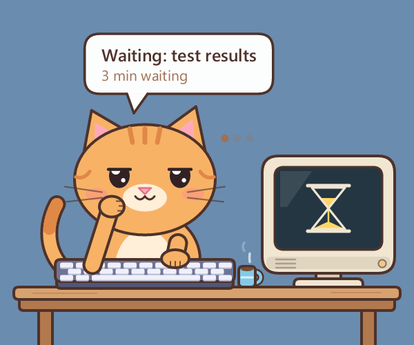 | 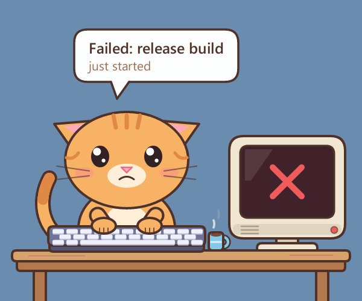 | 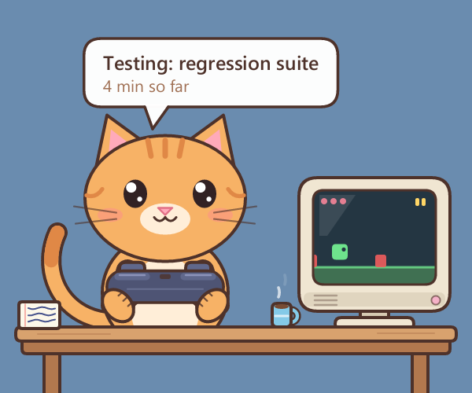 |

| Building | Researching | Downloading |
|----------|-------------|-------------|
| 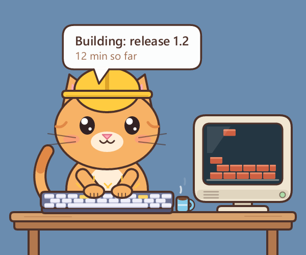 | 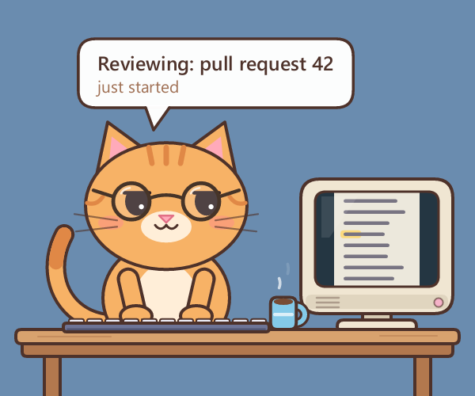 | 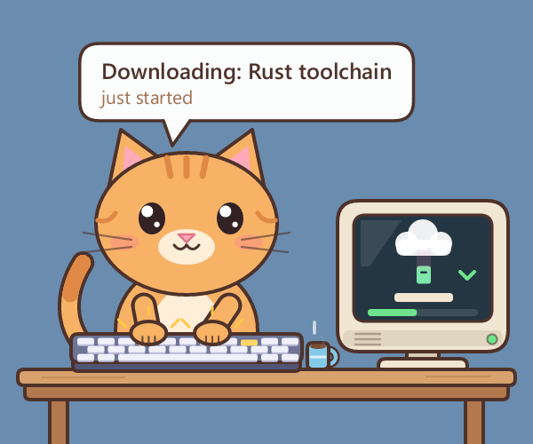 |

| Planning | All done | Napping |
|----------|----------|---------|
| 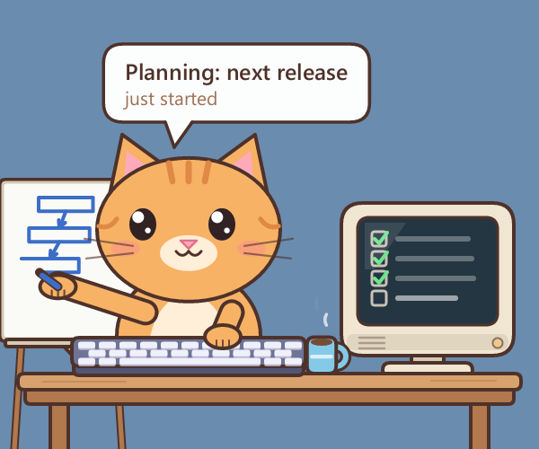 | 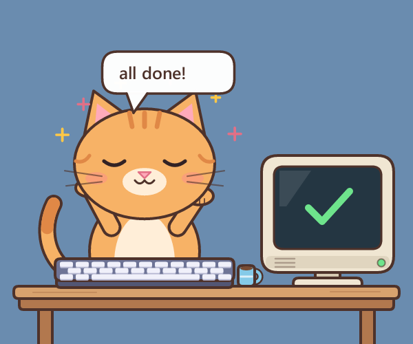 | 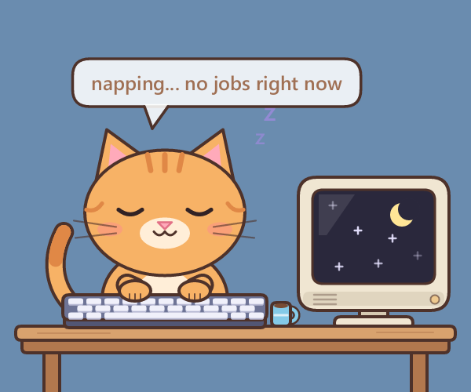 |

## The right-click menu

Drag the kitten anywhere with the left mouse button; it remembers the spot and opens there next time. Right-click it for its menu, a little cream card with cat ears that pops open:

| Item | What it does |
|------|--------------|
| **Back to corner** | moves the kitten back to the bottom-right of its display and forgets the dragged-to spot |
| **Monitor** | a page listing every display (with the number Windows uses in Display settings); pick one and the kitten moves there and starts there from then on |
| **Color** | a page of portraits, the kitten in each of its 32 coats (tabbies, solids, a tuxedo, pointed, calico and tortoiseshell, and fun ones up to galaxy and rainbow), so you can see a coat before you pick it. Patched coats get new patches each time you pick them |
| **Size** | a page from 50% to 300%; the kitten resizes at once. **Default** goes back to following your display scaling |
| **Always on top** | checked keeps the kitten above other windows; unchecked lets them cover it |
| **Quit** | closes the kitten |

Monitor, Color and Size slide in as pages with a back button. The keyboard works too: the arrow keys move, Enter or Space picks, Left or Backspace goes back, and Escape goes back or closes the menu. Clicking anywhere else closes it.

Every choice is saved in `kitten-assistant.ini` next to the exe. Delete that file to go back to all the defaults.

<p align="center">
  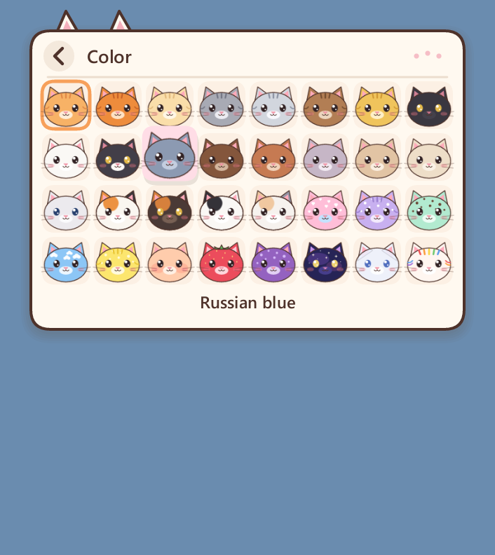
</p>

## Options

| Option | Meaning |
|--------|---------|
| `--status FILE` | the status file to watch or write (default `status.txt` next to the exe, or `%KITTEN_STATUS%`) |
| `--scale N` | size multiplier for this run; wins over right-click > Size (default: the saved size, else the screen's scaling) |
| `--monitor N` | start on display N and save it as the default |
| `--x N --y N` | start position in screen pixels (default: bottom-right of the default display) |

Options can go before or after the command. `kitten-assistant version` shows the version and `kitten-assistant help` the command summary, both in a message box.

## Found something?

| What you see | What to check |
|--------------|---------------|
| The kitten never wakes up | The kitten and your script use different status files. Use the same `--status` path or `KITTEN_STATUS` for both. |
| A script hangs on a `kitten-assistant` call | A message box is waiting for OK (maybe behind other windows). Usually the status started with `--`. |
| It keeps typing after the job ended | The job stopped before it wrote `idle`. |
| Nothing happens when I start it | A kitten is already running (maybe dragged off-screen): run `kitten-assistant quit` and start it again. |
| My screenshot has no kitten | Ordinary screenshot tools may miss see-through windows. Use `snapshot` (see below). |

Errors are written to `%TEMP%\kitten-assistant.log` (except a mistyped option, which only shows its message box). Still stuck? Open an [issue](https://github.com/Hailey-Ross/hails.Kitten-Assistant/issues/new) with what you did, what you saw and that log.

The **[full guide](docs/USAGE.md)** covers every command and option, the status file rules, scripts in several languages, recipes (wrappers, scheduled tasks, jobs on another computer, several jobs at once), the settings file and more troubleshooting.

## For developers

You need Rust on Windows 10 or 11 ([rustup.rs](https://rustup.rs)).

```
git clone https://github.com/Hailey-Ross/hails.Kitten-Assistant
cd hails.Kitten-Assistant
cargo build --release
cargo test --release
```

The exe lands in `target\release\kitten-assistant.exe`. A build of your own shows "(local build)" under `version` and never updates itself.

Changing how it draws? `cargo test --release -- --ignored --nocapture --test-threads=1 frame_` prints the time per frame for every mood (`FRAME_COST`), per drawing step (`FRAME_PART`) and one hash over the pixels of many frames (`FRAME_HASH`). A speed-up that leaves the hash the same draws exactly the same picture.

```
src/main.rs     command line, window, timers, see-through window output
src/scene.rs    the kitten, its moods, the desk and computer, and their animation
src/menu.rs     the right-click menu (pages, coat portraits, keyboard)
src/canvas.rs   drawing helpers (shapes, outline, text, word wrap)
src/update.rs   the self-updater (newest stable release, SHA-256 check, swap and restart)
docs/USAGE.md   the full guide
```

The art is drawn in code every frame with [tiny-skia](https://crates.io/crates/tiny-skia) (there are no image files), text uses [fontdue](https://crates.io/crates/fontdue) with Segoe UI from the Windows fonts folder, and each frame goes to Windows as a per-pixel-alpha layered window, so the kitten has soft edges on any wallpaper.

### How releases are made

The workflow in [`.github/workflows/release.yml`](.github/workflows/release.yml) tests and builds the exe on every push.

- A push to `main` replaces the `experimental` pre-release with the new build. Installed kittens never update to it, and it never updates itself.
- Publishing a GitHub release (not a pre-release) whose tag is `v` plus the version in `Cargo.toml` (for example `v0.1.1`) builds the exe for it and attaches `kitten-assistant.exe`, its `.sha256` and a `release.json` with the version and build number. That's what installed kittens update to. A tag that doesn't match the version fails the build.

### Snapshots

`snapshot` renders one frame to a PNG without opening a window, handy for checking art changes. The pictures in this README come from:

```
kitten-assistant snapshot busy.png --busy "Writing release notes" --minutes 12 --bg 6a8caf
kitten-assistant snapshot testing.png --busy "Testing: regression suite" --minutes 4 --bg 6a8caf
kitten-assistant snapshot building.png --busy "Building: release 1.2" --minutes 12 --bg 6a8caf
kitten-assistant snapshot researching.png --busy "Reviewing: pull request 42" --bg 6a8caf
kitten-assistant snapshot downloading.png --busy "Downloading: Rust toolchain" --time 3.4 --bg 6a8caf
kitten-assistant snapshot thinking.png --busy "Planning: next release" --time 4.4 --bg 6a8caf
kitten-assistant snapshot waiting.png --busy "Waiting: test results" --minutes 3 --time 4.2 --bg 6a8caf
kitten-assistant snapshot problem.png --busy "Failed: release build" --bg 6a8caf
kitten-assistant snapshot done.png --done --time 3.3 --bg 6a8caf
kitten-assistant snapshot nap.png --bg 6a8caf
```

`--time SECONDS` picks the animation moment and `--scale N` the size (default 2). `--screen N` picks the typing screen (0 code, 1 progress bars, 2 equalizer, 3 gear, 4 graph), `--sip` draws a coffee sip, `--coat NAME` picks a color (for example `--coat "Gray tabby"`) and `--seed N` moves the patches on patched coats. Leave out `--bg` for a transparent PNG.

## License

MIT. See [LICENSE](LICENSE).
